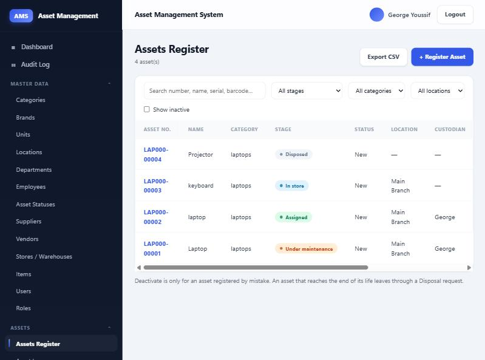
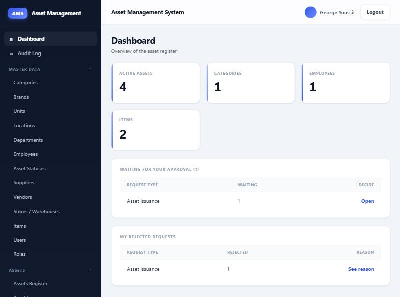
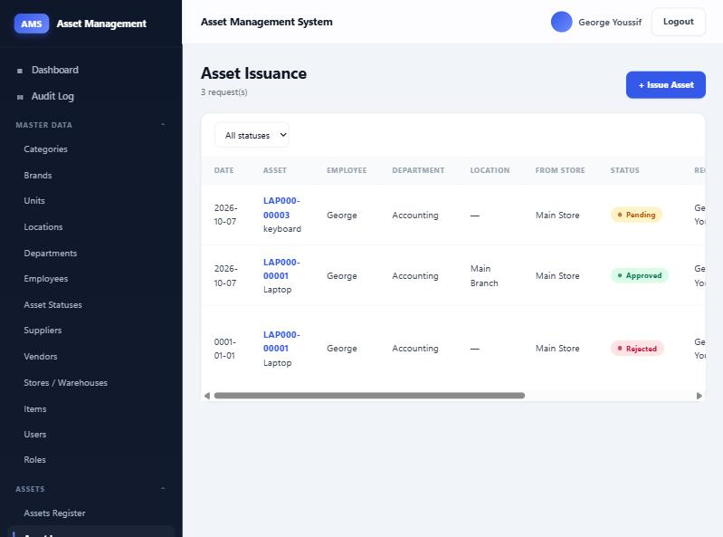
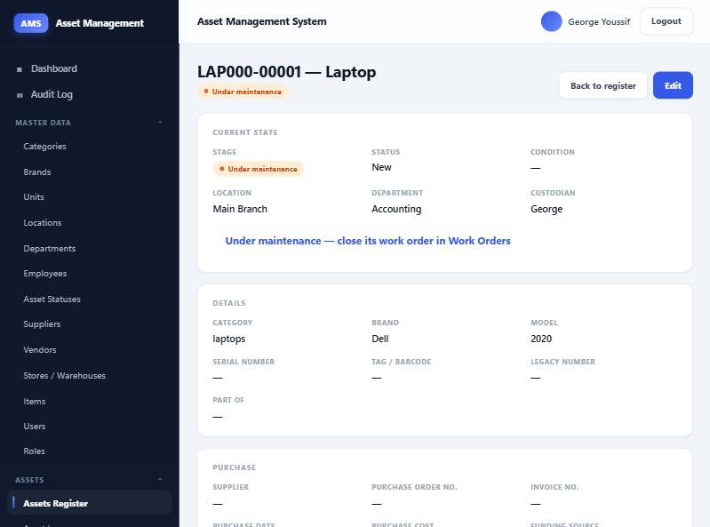
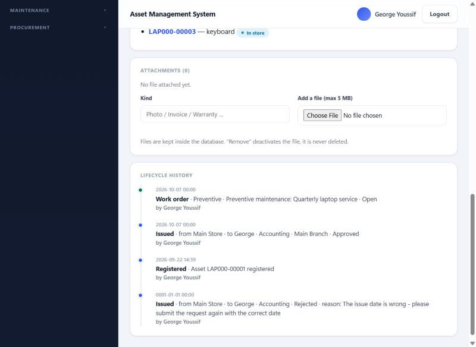
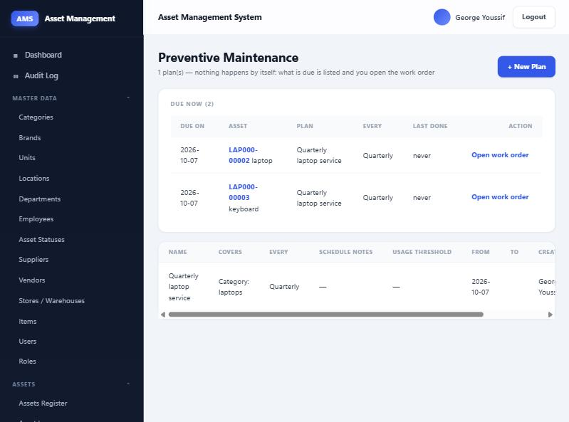
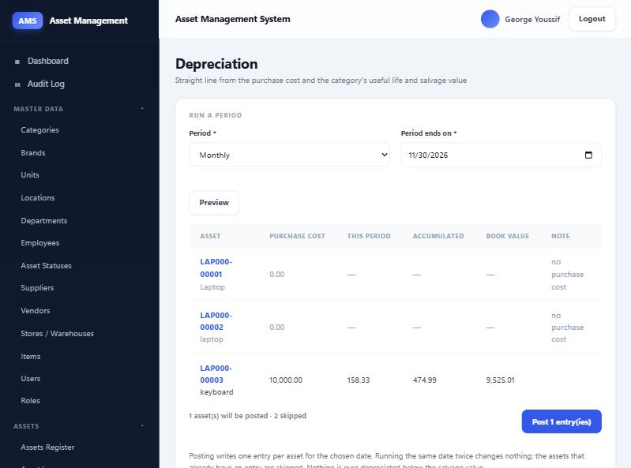
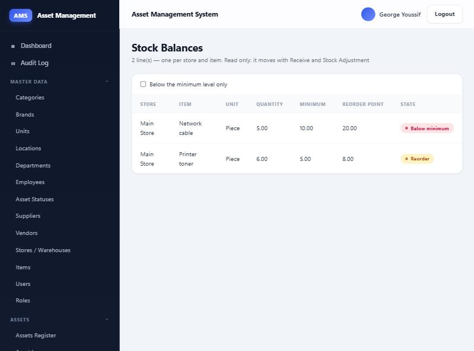
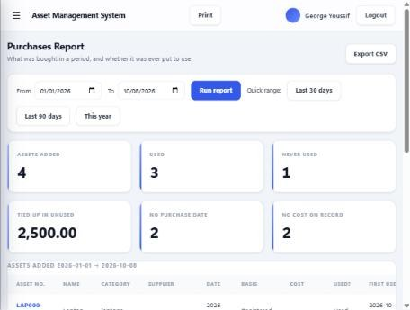
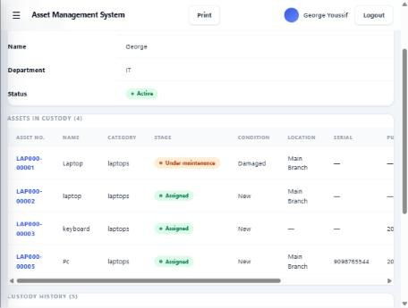

# AMS — Asset Management System

A fixed-asset management system for tracking an organisation's assets from registration to
disposal: who holds each asset, where it is, what happened to it, and what it is worth today.

Built with **Blazor Server (.NET 8)** and **Entity Framework Core 8** on **SQL Server**,
organised in **Clean Architecture**.



---

## What it does

Every asset has one record and one timeline. Every movement — issuing it to an employee,
returning it, transferring it, reporting damage, maintaining it, writing it off — is a
transaction that updates the asset and leaves a line in its history.

### Asset lifecycle

An asset is always in exactly one stage, and **only transactions change it**:

```
In store ──issue──► Assigned ──return──► In store
    │                   │
    │                   └──transfer──► In transit ──confirm receipt──► Assigned / In store
    │
    ├──work order──► Under maintenance ──close──► In store
    └──disposal approved──► Disposed   (final)
```

### Modules

| Area | Screens |
|---|---|
| **Assets** | Register (search, filter, paging, CSV export) · Issuance · Transfer · Disposal · Revaluation · Depreciation · Verification campaigns |
| **Inventory** | Receive · Return · Stock adjustments · Stock balances |
| **Maintenance** | Preventive plans · Work orders · Contracts (AMC) · Incidents |
| **Procurement** | Purchase orders · Invoices · Suppliers |
| **Reports** | Purchases & usage — what entered the books in a period and whether it was ever put to use |
| **Master data** | Categories · Brands · Units · Locations · Departments · Employees (searchable, with a custody page) · Asset statuses · Suppliers · Vendors · Stores · Items · Users · Roles |
| **Administration** | Audit log · Role management |

### Screens

| | |
|---|---|
| **Dashboard** — counters, what is waiting for the admin's decision, and your own rejected requests | **Asset issuance** — request, approve or reject with a reason |
|  |  |
| **Asset page** — current stage, custody, and the actions allowed at this stage | **Lifecycle history** — every transaction that touched the asset, plus its attachments |
|  |  |
| **Preventive maintenance** — what is due now; the work order is opened by a button, never automatically | **Depreciation** — preview every asset before posting, with the reason each skipped one was skipped |
|  |  |
| **Stock balances** — one line per store and item, flagged against the item's minimum and reorder point | **Purchases & usage** — what entered the books in a period, what was used, and what is still sitting unused |
|  |  |
| **Employee custody** — everything one person holds, their full custody history, and a printable statement for them to sign | |
|  | |

### How work gets approved

Requests that move or retire an asset (issuance, transfer, incidents, disposal) are created as
`Pending` and decided by the **Admin** role. A rejection always carries a reason, which the
requester sees. Transactions that only record a fact (return, receive, stock adjustment,
revaluation) apply immediately.

### Reporting

**Purchases & usage** answers one question over a date range: *what did we buy, and did we
ever use it?* An asset counts as used once it has had one approved custody — whenever that
happened — and the report shows how long it waited. Consumable items are reported alongside:
what was received against what left the stores in the same period.

Nothing is silently dropped. An asset entered without a purchase date is still reported, dated
by its registration instead and marked `Registered` in the **Basis** column, and two counters
show how many rows are missing a purchase date or a cost.

### Other behaviour worth knowing

- **Nothing is ever hard-deleted.** Every table has `IsActive`; "Delete" is always *Deactivate*.
- **Asset numbers are generated** from the category prefix (`LAP000-00001`) and never change.
- **One asset, one open request.** An asset inside an unfinished issuance, transfer or disposal
  cannot be put into another one.
- **Straight-line depreciation** is computed from purchase cost, the category's useful life
  (in years) and its salvage value, posted monthly or annually, and never goes below salvage.
- **Full audit trail**: every insert, update and deactivation is recorded with the old and new
  values, plus login, logout and failed logins. Passwords are never recorded.
- **Attachments** (photos, invoices, contracts) are stored in the database, up to 5 MB each.
- **Custody belongs to the employee, not the login.** Every user account is linked to exactly
  one employee, and one employee has at most one active account — enforced by a filtered unique
  index, not only by the screen.
- **Assigning is one step for the admin, a request for everyone else.** The same button on the
  employee and asset screens moves the asset immediately for an Admin, and raises a `Pending`
  request for anyone else. Either way the step is written to the audit log.
- **Every screen prints.** The sidebar, filters, buttons and action columns drop out, table
  headers repeat on each page, and the employee page prints as an **asset custody statement**
  with signature lines for the custodian, the store keeper and the administrator.

---

## Architecture

```
AMS.Domain          entities and enums only — no packages, no dependencies
AMS.Application     interfaces, DTOs and contracts — depends on Domain only
AMS.Infrastructure  EF Core, DbContext, migrations, service implementations
AMS.Web             Blazor Server UI — depends on Application + Infrastructure
```

The dependency arrow points inwards: the UI never references EF Core, and the domain never
references anything. Every screen talks to an interface in `AMS.Application`.

Authentication is **cookie authentication over the project's own `Users` table** — no ASP.NET
Identity and no minimal-API endpoints. Passwords are hashed with PBKDF2-SHA256, 600,000
iterations, in the format `iterations.salt.hash`.

---

## Getting started

### Requirements

- .NET 8 SDK
- SQL Server 2014 or newer (Express is fine)
- `dotnet-ef` tool: `dotnet tool install --global dotnet-ef`

### 1. Point it at your database

`appsettings.json` ships with a placeholder server name. Put your own one in
`src/AMS.Web/appsettings.Development.json`, which is git-ignored so nobody's local server
name or credentials ever reach the repository:

```json
{
  "ConnectionStrings": {
    "DefaultConnection": "Server=YOUR-SERVER\\SQLEXPRESS;Database=AssetManagementDb;Trusted_Connection=True;TrustServerCertificate=True;MultipleActiveResultSets=true"
  }
}
```

### 2. Create the database

```bash
dotnet ef database update -p src/AMS.Infrastructure -s src/AMS.Web
```

### 3. Run

```bash
dotnet run --project src/AMS.Web
```

### 4. Create the first account

The database starts empty, so **`/account/setup` opens by itself**. The account you create
there automatically receives the **Admin** role, and the setup page closes permanently
afterwards. Every later account is created by the Admin from **Master Data → Users**.

> Roles are read from the cookie **at login**. After a role is granted, that user must log out
> and back in for it to take effect.

### 5. Fill the master data

Categories (with a numbering prefix, useful life and salvage value) → asset statuses →
locations → departments → employees → stores. Then register assets.

---

## SQL Server 2014 note

EF Core 8 translates `Where(x => ids.Contains(x.Id))` using `OPENJSON ... WITH`, which only
exists from SQL Server 2016. The project therefore pins the compatibility level:

```csharp
options.UseSqlServer(connectionString, sql => sql.UseCompatibilityLevel(120));
```

**Remove that argument if you move to SQL Server 2016 or newer** — it only exists to support 2014.

---

## Migrations

| Migration | What it does |
|---|---|
| `InitialCreate` | First schema |
| `AmsModelUpdate` | Restructure to the approved entity list |
| `AddAssetLifecycleStage` | `Asset.LifecycleStage` |
| `IssuanceAndAssignment` | Issuance and custody |
| `Batch1Transactions` | Incident type as an enum, incident links on work orders and disposals |
| `CleanupColumnDefaults` | Removes leftover `DEFAULT 0` constraints from required columns |
| `AdminRoleAndAttachments` | Preventive-plan link, attachment contents, renames the `Approver` role to `Admin` |
| `UserEmployeeLink` | `User.EmployeeId` — the person a login belongs to |
| `OneLoginPerEmployee` | Makes that link unique among active accounts |

Three of these contain **hand-written corrections** (EF scaffolded a `RenameColumn` between
unrelated columns, and an `AlterColumn` from `nvarchar` to `int` that SQL Server rejects). They
are marked with `// NOTE (hand-edited)` comments. **Always read a newly scaffolded migration
before running `database update`.**

---

## What is deliberately not here

- No hard delete anywhere.
- No barcode generation (dropped by decision).
- Paging is applied to every list that grows with use, employees and users included; short
  lookup lists (units, brands, asset statuses) load in full.
- Transfers and disposals handle one asset at a time in the UI, although the schema supports
  several.

---

## Licence

Internal project.
